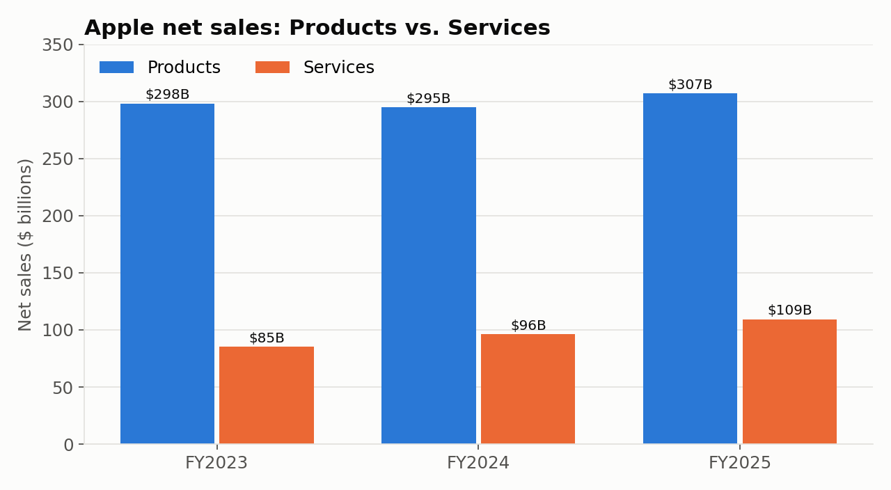
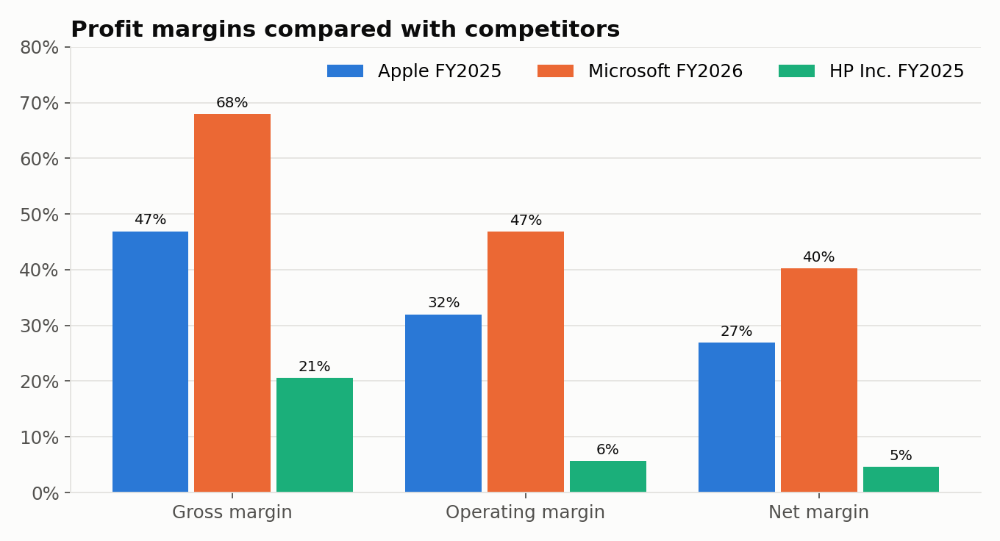

# Apple Financial Statement and Ratio Analysis

I built this for my accounting class. The goal was to take Apple's real financial statements, turn them into ratios, and see how Apple stacks up against two competitors and the industry. It's also the base for a set of projected statements I'm building next.

**Tools:** Excel

**Data:** Apple's Form 10-K filings for fiscal 2023 to 2025, plus Microsoft's and HP's latest 10-Ks, all from SEC EDGAR. Industry averages come from FullRatio and Professor Aswath Damodaran's industry data (NYU Stern).

## What's in the workbook

- **Apple's income statement, balance sheet, and cash flow statement** for three years, entered from the 10-Ks, with check rows that confirm assets equal liabilities plus equity and that ending cash ties to the balance sheet.
- **The same three statements for Microsoft and HP Inc.**
- **A ratio sheet** covering liquidity, leverage, activity, and profitability. Every ratio is a formula linked to the statement sheets, so if a number changes the ratios update on their own.
- **Notes on anything unusual,** like why a ratio shows N/A or N/M.

## What I found

- **Services is driving the growth.** Total sales rose from $383.3 billion to $416.2 billion over the three years. Services went from $85.2 billion to $109.2 billion (up 28%), while product sales only grew about 3%.
- **That mix is lifting margins.** Services keeps about 75 cents of every dollar as gross profit, compared to about 37 cents for products. Apple's overall gross margin climbed from 44.1% to 46.9%.
- **The current ratio is below 1 (0.89 in FY2025).** For most companies that would be a red flag. Apple brought in $111.5 billion of operating cash in FY2025, so it has no trouble paying its short-term bills.
- **Debt to equity (3.87) and return on equity (152%) both look extreme.** The reason is the same for both: Apple spent $90.7 billion buying back its own stock in FY2025 alone, which keeps shareholders' equity small. Those two ratios say more about the buybacks than about risk or performance.
- **Apple sits between its competitors on profit.** Its net margin was 26.9%, compared to 40.3% for Microsoft (mostly software and cloud) and 4.6% for HP (mostly PCs and printers).
- **FY2024 net income dipped even though operating income went up.** That year's tax expense included a one-time $10.2 billion charge from the European Union state aid case. Without it, earnings would have kept rising.

*These preview charts were made from the numbers in the workbook so they show up on GitHub.*

## Files

| File | What it is |
|---|---|
| `Apple Financial Statement and Ratio Analysis.xlsx` | Full workbook: statements for all three companies plus the ratio analysis |

## Notes

- Apple stopped reporting interest expense separately after FY2023, so times interest earned is N/A for FY2024 and FY2025.
- HP has negative shareholders' equity, so ratios that divide by equity are marked N/M (not meaningful).
- Microsoft's fiscal year ends in June and HP's ends in October, so the years don't line up exactly with Apple's (September). The comparison uses each company's most recent full year.
